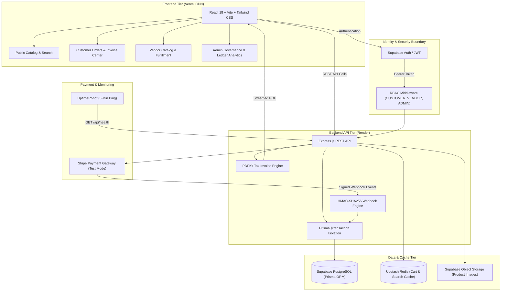

# UrbanBasket - Multi-Vendor E-Commerce Marketplace

[]()
[]()
[]()
[]()

> UrbanBasket is an Amazon-style multi-vendor e-commerce marketplace platform built with React 18, TypeScript, Node.js, Express, Prisma ORM, PostgreSQL, and Upstash Redis. It features independent vendor stores, verified purchase reviews, atomic checkout transactions, payment webhook settlement, dynamic PDF tax invoices, and real-time administrative ledger analytics.

---

## 1. System Architecture



---

## 2. Feature Matrix

### 2.1 Customer Storefront & Commerce
- **Public Catalog**: Full-text keyword search (`q`), category filters, price range sliders, minimum rating filters ($\ge 4\star$), in-stock toggles, and multi-field sorting.
- **Persistent Redis Cart**: Sub-millisecond cart updates persisted across browser sessions with live inventory validation.
- **Coupon Engine**: Server-side promotional code validation (`WELCOME10`, `FLASH20`) with percentage/fixed discounts, minimum spend thresholds, and usage limits.
- **Atomic Checkout**: Transactional stock reservations preventing inventory overselling, multi-vendor payout splitting, and automated order generation.
- **Payment Processing**: Stripe Payment Intent generation, test card simulator, and cryptographically verified HMAC-SHA256 webhook settlement.
- **Order Timeline & Fulfillment**: Live tracking of multi-vendor orders with granular status indicators.
- **1-Click PDF Tax Invoices**: Dynamic, server-side PDF invoice generation via PDFKit featuring company headers, tax breakdown, and itemized receipts.
- **Verified Purchase Reviews**: 5-star rating and comment submissions restricted strictly to customers who have taken delivery of the product, with duplicate review prevention.

### 2.2 Vendor Portal
- **Vendor Onboarding**: Self-service merchant registration in `PENDING` status awaiting admin verification.
- **Catalog Management**: Full product lifecycle management (Draft, Published, Archived) with image gallery uploads.
- **Vendor-Scoped Order Fulfillment**: Unidirectional fulfillment state machine:
  $$\text{PLACED} \longrightarrow \text{PACKED} \longrightarrow \text{SHIPPED} \longrightarrow \text{DELIVERED}$$
- **Merchant Analytics**: Store-specific gross sales, platform commission deductions ($10\%$), net vendor payouts, and fulfillment metrics.

### 2.3 Administrator Platform Governance
- **Vendor Approvals**: Review pending vendor applications, approve or reject merchants, and configure custom commission rates.
- **Review Moderation**: Approve or flag customer reviews with automatic recalculation of product `averageRating` and `reviewCount`.
- **Coupon Management**: Create, update, or revoke platform coupon campaigns with date and usage constraints.
- **Financial Ledger & Analytics**: High-level platform ledger with double-entry reconciliation:
  $$\text{Gross Revenue} = \text{Platform Commission} + \text{Vendor Payouts}$$
  along with order status distributions, customer growth tracking, and top-selling products and merchants.

---

## 3. Tech Stack

| Domain | Technologies |
|---|---|
| **Frontend** | React 18, TypeScript, Vite, Tailwind CSS, Lucide React, Context API |
| **Backend** | Node.js, Express, TypeScript, Zod, PDFKit, Stripe SDK |
| **Database & ORM** | PostgreSQL 16 (Supabase), Prisma ORM v5 (12 models, 9 enums) |
| **Cache & Sessions** | Upstash Redis (REST-based serverless client) & local Redis 7 fallback |
| **Storage** | Supabase Storage (public/private image buckets) |
| **Testing** | Vitest, Supertest, React Testing Library, Custom Load Testing Benchmarks |
| **DevOps & Infra** | Docker, Docker Compose, Render (Backend), Vercel (Frontend), UptimeRobot |

---

## 4. Local Setup & Development

### 4.1 Prerequisites
- Node.js (v20+)
- npm (v10+)
- Docker & Docker Compose (optional for local PostgreSQL & Redis)

### 4.2 Clone & Install
```bash
git clone https://github.com/your-username/UrbanBasket.git
cd UrbanBasket

# Install all monorepo dependencies across workspaces
npm install
```

### 4.3 Environment Configuration
Copy the provided environment templates:
```bash
cp .env.example .env
cp backend/.env.example backend/.env
cp frontend/.env.example frontend/.env
```

### 4.4 Start Local Databases (Docker)
```bash
# Starts PostgreSQL (port 5432) and Redis (port 6379)
docker compose up -d
```

### 4.5 Run Migrations & Seed Database
```bash
# Generate Prisma Client
npm --workspace=backend run prisma:generate

# Apply migrations
npm --workspace=backend run prisma:migrate

# Seed demo users, categories, products, orders, and reviews
npm run seed:backend
```

### 4.6 Start Development Servers
```bash
# Start backend API (runs on http://localhost:5000)
npm run dev:backend

# In a separate terminal, start frontend UI (runs on http://localhost:5173)
npm run dev:frontend
```

---

## 5. Demo Accounts & 1-Click Evaluation

The web application includes a **1-Click Quick Demo Evaluation Bar** inside the Sign In modal:

| Role | Email | Password | Pre-Seeded Capabilities |
|---|---|---|---|
| **Customer** | `customer@urbanbasket.com` | `password123` | Active customer profile with delivered orders ready for PDF invoice download and verified review submission. |
| **Vendor** | `technest@urbanbasket.com` | `password123` | Approved merchant ("TechNest Electronics") with active catalog and orders to fulfill. |
| **Pending Vendor** | `artisan@urbanbasket.com` | `password123` | Pending vendor application ("Artisan Woodcraft & Co") ready for admin review. |
| **Administrator** | `admin@urbanbasket.com` | `password123` | Platform superuser with access to vendor approvals, review moderation, and financial analytics. |

---

## 6. Testing & Quality Verification

UrbanBasket features automated test suites and high-concurrency benchmarks:

```bash
# 1. Run all 57 backend tests (auth, vendor, catalog, checkout, payments, reviews, analytics, health)
npm run test:backend

# 2. Run frontend component tests (AuthModal, ReviewModal, Cart, forms)
npm run test:frontend

# 3. Run high-concurrency API performance load test (100 reqs, concurrency 10)
npm run test:load

# 4. Verify TypeScript builds across workspaces
npm run build:backend
npm run build:frontend
```

### Load Test Benchmark Summary
```text
┌─────────┬──────────────────────────────────────────────────────────────┬──────┬─────────────┬──────────────┬───────┬──────────┬──────────┬──────────┬──────────┬───────────┐
│ (index) │ Endpoint                                                     │ Reqs │ Concurrency │ Success Rate │ RPS   │ Avg (ms) │ p50 (ms) │ p95 (ms) │ p99 (ms) │ Cache Hit │
├─────────┼──────────────────────────────────────────────────────────────┼──────┼─────────────┼──────────────┼───────┼──────────┼──────────┼──────────┼──────────┼───────────┤
│ 0       │ '/api/v1/products'                                           │ 100  │ 10          │ '100.0%'     │ 485.4 │ 19.0     │ 12       │ 77       │ 79       │ '99.0%'   │
│ 1       │ '/api/v1/products?category=electronics&sort=price&order=asc' │ 100  │ 10          │ '100.0%'     │ 719.4 │ 12.6     │ 12       │ 16       │ 16       │ '99.0%'   │
│ 2       │ '/api/health'                                                │ 100  │ 10          │ '100.0%'     │ 961.5 │ 9.5      │ 10       │ 11       │ 12       │ '0.0%'    │
└─────────┴──────────────────────────────────────────────────────────────┴──────┴─────────────┴──────────────┴───────┴──────────┴──────────┴──────────┴──────────┴───────────┘
```

---

## 7. Production Deployment

### 7.1 Frontend (Vercel)
- Configured via [frontend/vercel.json](file:///Users/deepakrana/Desktop/WebDev/Projects/UrbanBasket/frontend/vercel.json) with SPA rewrites to `/index.html` and security response headers.
- **Public URL**: `https://urbanbasket-frontend.vercel.app` (or your configured Vercel domain).

### 7.2 Backend (Render)
- Configured via [render.yaml](file:///Users/deepakrana/Desktop/WebDev/Projects/UrbanBasket/render.yaml) as a Node.js Web Service with automatic Prisma generation and health check monitoring on `/api/health`.
- **Public URL**: `https://urbanbasket-backend.onrender.com`.

### 7.3 UptimeRobot Monitoring
- UptimeRobot is configured to ping `GET /api/health` every 5 minutes to prevent Render free-tier instance cold sleep.

---

## 8. Free-Tier Limitations & Mitigations

| Limitation | Impact | Applied Mitigation |
|---|---|---|
| **Render Spin-down** | Free instances sleep after 15 min of inactivity. | Configured UptimeRobot 5-minute HTTP heartbeat against `/api/health`. |
| **Supabase Storage** | Limited free egress and file storage quotas. | 2 MB file limit enforced, 5 images per product max, WebP/JPEG format validation. |
| **Upstash Redis Quota** | Daily command limits on serverless free tiers. | Smart Redis caching with selective TTLs (120s for catalog queries, 7-day TTL for carts). |
| **Stripe Test Mode** | Production bank transfers cannot be settled to free test accounts. | Test PaymentIntent checkout and HMAC webhook simulation, with ledger split records tracked in PostgreSQL. |

---

## 9. Future Roadmap
1. **Stripe Connect Automated Payouts**: Direct ACH / bank transfers to verified vendor bank accounts upon delivery confirmation.
2. **Elasticsearch / Meilisearch**: Advanced faceted search with typo-tolerance and auto-suggestions.
3. **WebSockets / Push Notifications**: Real-time order status updates for customers and live incoming order alerts for vendors.
4. **Multi-Currency Checkout**: Dynamic currency conversion with localized payment methods (UPI, iDEAL, Klarna).

---

## 10. Documentation Index
- [System Architecture](file:///Users/deepakrana/Desktop/WebDev/Projects/UrbanBasket/docs/architecture.md)
- [Database Schema & ER Diagram](file:///Users/deepakrana/Desktop/WebDev/Projects/UrbanBasket/docs/database-schema.md)
- [REST API Specification](file:///Users/deepakrana/Desktop/WebDev/Projects/UrbanBasket/docs/api.md)
- [Postman Collection](file:///Users/deepakrana/Desktop/WebDev/Projects/UrbanBasket/docs/postman_collection.json)
- [Comprehensive Test Results](file:///Users/deepakrana/Desktop/WebDev/Projects/UrbanBasket/docs/test-results.md)
- [Demonstration & Evaluation Guide](file:///Users/deepakrana/Desktop/WebDev/Projects/UrbanBasket/docs/demo-guide.md)
- [Engineering Reflections](file:///Users/deepakrana/Desktop/WebDev/Projects/UrbanBasket/docs/individual-reflections/reflections.md)
- [Monitoring & Health](file:///Users/deepakrana/Desktop/WebDev/Projects/UrbanBasket/docs/monitoring.md)
