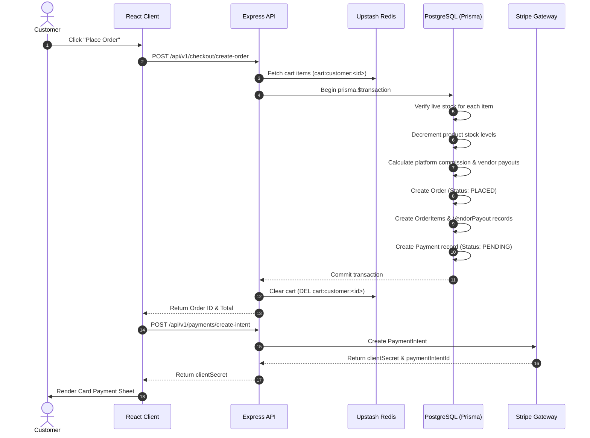
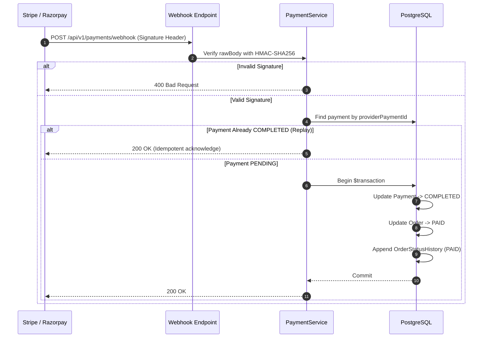

# UrbanBasket - System Architecture & Technical Design

## 1. High-Level Architecture Overview
UrbanBasket is an enterprise-ready, multi-vendor marketplace engine engineered for scalability, consistency, and separation of concerns.

```mermaid
flowchart TD
    subgraph Clients["Presentation Layer (Client)"]
        SPA["React 18 + Vite SPA\n(Vercel CDN)"]
        CustomerUI["Customer Storefront & Checkout"]
        VendorUI["Vendor Portal & Catalog Management"]
        AdminUI["Admin Governance & Financial Ledger"]
        SPA --> CustomerUI
        SPA --> VendorUI
        SPA --> AdminUI
    end

    subgraph Security["Identity & Security Boundary"]
        SupabaseAuth["Supabase Auth / JWT"]
        RoleGuard["RBAC Authorization Middleware\n(CUSTOMER | VENDOR | ADMIN)"]
    end

    subgraph AppService["Application Layer (Backend)"]
        API["Express.js REST API\n(Render Web Service)"]
        Zod["Zod Input Validation"]
        TxMgr["Prisma Atomic Transaction Manager"]
        InvoiceGen["PDFKit Tax Invoice Engine"]
        WebhookHandler["Idempotent HMAC Webhook Engine"]
    end

    subgraph DataServices["Data & Cache Layer"]
        Postgres[("Supabase PostgreSQL\n(Prisma ORM)")]
        Redis[("Upstash Redis\n(REST / Low Latency)")]
        Storage["Supabase Object Storage\n(Product Media Bucket)"]
    end

    subgraph ExternalGateways["Payment & Monitoring"]
        PaymentGW["Stripe / Razorpay\n(Payment Intents & Webhooks)"]
        Uptime["UptimeRobot\n(5-minute Heartbeat Monitor)"]
    end

    CustomerUI -->|REST API Calls| API
    VendorUI -->|REST API Calls| API
    AdminUI -->|REST API Calls| API

    CustomerUI -->|Sign In / OAuth| SupabaseAuth
    SupabaseAuth -->|Bearer JWT| RoleGuard
    RoleGuard --> API

    API --> Zod
    Zod --> TxMgr
    TxMgr -->|Queries & Transactions| Postgres
    API -->|Session Carts & Catalog Cache| Redis
    API -->|Image Uploads (Service Role)| Storage
    API --> InvoiceGen
    InvoiceGen -->|Streamed PDF Binary| CustomerUI

    API -->|Create Intent| PaymentGW
    PaymentGW -->|Signed Event Webhook| WebhookHandler
    WebhookHandler -->|Atomic Settle| TxMgr

    Uptime -->|GET /api/health| API
```

---

## 2. Component Design & Roles

### 2.1 Frontend Presentation Tier (`frontend/`)
- Built with **React 18**, **TypeScript**, **Tailwind CSS**, and **Lucide React**.
- Fast state hydration using typed Contexts:
  - `AuthContext`: Tracks JWT token, user profile, role, and exposes a 1-click test role switcher for demo evaluation.
  - `CartContext`: Communicates directly with backend Redis cart endpoints with optimistic quantity updates and badge indicators.
- Role-gated modular routing:
  - Public Storefront: Catalog with real-time category filtering, price sliders, star rating filters, sorting, and pagination.
  - Customer Hub: Real-time orders timeline, 1-click tax invoice downloads, and verified purchase review modal.
  - Vendor Dashboard: Store setup, real-time inventory management, order status transitions (`PLACED` $\to$ `PACKED` $\to$ `SHIPPED` $\to$ `DELIVERED`), and revenue metrics.
  - Admin Operations: Vendor onboarding approval workflows, coupon rule creation, review moderation, and financial ledger analysis.

### 2.2 Backend Application Tier (`backend/`)
- Built with **Node.js**, **Express**, and **TypeScript**.
- Strict layer segregation:
  - `routes/`: Declares endpoints and connects middleware.
  - `middleware/`: JWT verification, RBAC permissions check, and Zod body validation.
  - `controllers/`: Handles HTTP parameters, parses query strings, and standardizes JSON envelopes.
  - `services/`: Encapsulates business logic, database transactions, Redis cart management, and payment reconciliation.
  - `config/`: Singleton database and Redis connection clients.

---

## 3. Data Flow & Transaction Lifecycle

### 3.1 Atomic Checkout & Stock Decrement


### 3.2 Payment Settlement & Webhook Verification


---

## 4. Caching & Persistence Strategy

### Upstash Redis Key Schema
| Key Pattern | Data Structure | TTL | Purpose |
|---|---|---|---|
| `cart:customer:<userId>` | JSON string / Hash | 7 Days | High-speed, persistent customer shopping cart |
| `catalog:list:<queryStringHash>` | JSON string | 120 Seconds | Pre-computed catalog pagination & search results |
| `product:detail:<productId>` | JSON string | 300 Seconds | Single product details with vendor profile |

---

## 5. Security & Isolation Boundaries
1. **Server-Side Financial Authority**:
   - Product pricing, coupon discounts, platform commissions ($10\%$), and vendor payouts are exclusively computed in backend services. Client-submitted prices are discarded.
2. **Strict Multi-Vendor Scoping**:
   - Prisma queries for vendor operations always bind `where: { vendorId: req.user.vendorProfile.id }`. A vendor cannot view or modify competitor catalogs or orders.
3. **Verified Purchase Review Integrity**:
   - Customer review submissions require an `orderItemId` referencing a delivered order line item (`status: DELIVERED`) authored by `req.user.id`. Duplicate reviews on the same order item are rejected at the database schema level (`@unique(orderItemId)`).
4. **PDF Tax Invoice Protection**:
   - Invoice downloads are authenticated and strictly restricted to the order's placing customer or a platform administrator.
