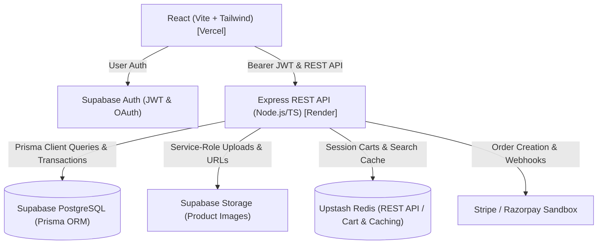

# UrbanBasket - Target System Architecture

## Overview
UrbanBasket is a multi-vendor e-commerce marketplace modeled after modern marketplace architectures (like Amazon), allowing Customers, Vendors, and Administrators to interact within a unified, resilient system.

## Hosting & Cloud Services
- **Frontend**: Vercel (Single-Page Application deployment)
- **Backend**: Render (Node.js Web Service)
- **Database**: Supabase PostgreSQL
- **Storage**: Supabase Storage Buckets
- **Caching**: Upstash Redis (Serverless REST client)
- **Health & Monitoring**: UptimeRobot
