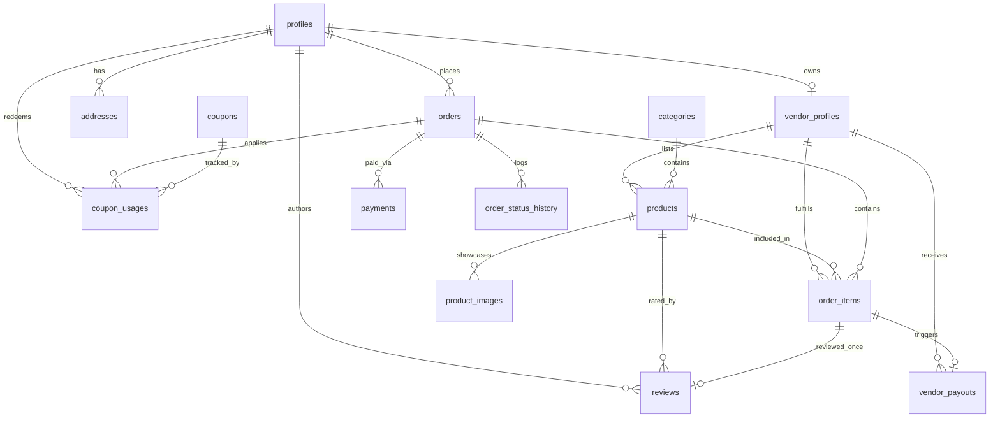

# UrbanBasket - Database Schema Specification

## Schema Architecture & ER Overview
UrbanBasket employs a PostgreSQL database managed via **Prisma ORM**. All monetary amounts are strictly persisted as `Decimal(10, 2)` or `Decimal(5, 4)` for commission rates to prevent floating-point calculation inaccuracies.

---

## Models & Enums

### Enums
- **`Role`**: `CUSTOMER`, `VENDOR`, `ADMIN`
- **`VendorStatus`**: `PENDING`, `APPROVED`, `REJECTED`, `SUSPENDED`
- **`ProductStatus`**: `DRAFT`, `PUBLISHED`, `UNPUBLISHED`, `OUT_OF_STOCK`
- **`OrderStatus`**: `PLACED`, `PACKED`, `SHIPPED`, `DELIVERED`, `CANCELLED`, `REFUNDED`
- **`PaymentStatus`**: `PENDING`, `COMPLETED`, `FAILED`, `REFUNDED`
- **`PaymentProvider`**: `STRIPE`, `RAZORPAY`
- **`ReviewStatus`**: `PENDING`, `APPROVED`, `REJECTED`
- **`CouponType`**: `PERCENTAGE`, `FIXED`
- **`PayoutStatus`**: `PENDING`, `PROCESSING`, `PAID`, `FAILED`

---

### Core Tables Summary

| Table | Primary Purpose | Key Constraints |
| :--- | :--- | :--- |
| **`profiles`** | Application user metadata mapped to Supabase Auth (`supabaseUserId`). | `@unique(supabaseUserId)`, `@unique(email)` |
| **`vendor_profiles`** | Multi-vendor shop profile, approval status, and commission rates. | `@unique(userId)`, `@unique(storeSlug)` |
| **`categories`** | Catalog categorization with SEO-friendly slugs. | `@unique(slug)` |
| **`products`** | Vendor goods, pricing, stock levels, and aggregate review ratings. | `@unique(slug)`, `@index([price])`, `@index([status])`, `@index([averageRating])` |
| **`product_images`** | Storage URLs, position order, and accessibility alt texts. | `@index([productId])` |
| **`addresses`** | Customer delivery details with phone and postal codes. | `@index([userId])` |
| **`orders`** | Multi-vendor order headers with discounts, commissions, and payment states. | `@index([customerId])`, `@index([status])`, `@index([paymentStatus])` |
| **`order_items`** | Granular line items linking individual products, vendors, and split payouts. | `@index([orderId])`, `@index([vendorId])`, `@index([productId])` |
| **`payments`** | Webhook-verified payment transactions. | `@unique(providerPaymentId)` |
| **`reviews`** | Customer feedback restricted strictly to verified purchased order items. | `@unique(orderItemId)`, `@unique([customerId, orderItemId, productId])` |
| **`coupons`** | Promotional vouchers with percentage or fixed discounts and usage limits. | `@unique(code)` |
| **`coupon_usages`** | Audit trail recording coupon redemptions per customer order. | `@index([couponId])`, `@index([customerId])`, `@index([orderId])` |
| **`vendor_payouts`** | Net payout records calculated per order line item. | `@unique(orderItemId)` |
| **`order_status_history`** | Immutable lifecycle audit trail for order status transitions. | `@index([orderId])` |

---

## Seed Data & Demo Accounts
Defined in [seed/demo-credentials.json](file:///Users/deepakrana/Desktop/WebDev/Projects/UrbanBasket/seed/demo-credentials.json):
- **Admin**: `admin@urbanbasket.com`
- **Approved Vendor 1**: `technest@urbanbasket.com` (TechNest Electronics)
- **Approved Vendor 2**: `greenliving@urbanbasket.com` (GreenLiving Organics)
- **Pending Vendor**: `artisan@urbanbasket.com` (Artisan Woodcraft & Co)
- **Customer**: `customer@urbanbasket.com` (Priya Patel, pre-seeded with delivered multi-vendor order)
